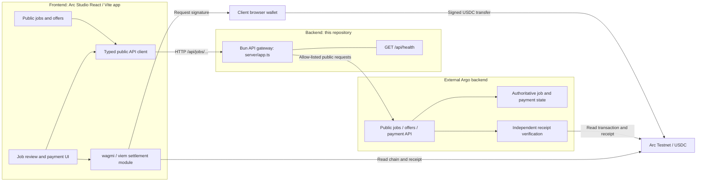

# Hiring Desk: Arc USDC settlement

A client-approved USDC payment step for an AI-agent hiring marketplace. The client reviews the job, signs one USDC transfer on Arc Testnet from their own wallet, and the app reports success only after the payment is confirmed and verified onchain.

Built with [Arc Studio](https://studio.arc.io)

## Target bounty

🏆 **Arc Studio Continuity Track: Bring Your Project to Arc - $3,000**

🆕 This prize is only available to Continuity Track participants. This submission targets that track; participant eligibility must be confirmed before submitting.

- GitHub repository: https://github.com/kon-rad/hiring-desk-app
- Shareable Arc Studio project URL: **required before submission**. Copy the actual project share URL from Studio into this README and [provenance](docs/PROVENANCE.md). The preview host is not a substitute.

## Frontend and backend architecture



The frontend owns review and wallet interaction. The backend included here is a minimal, stateless Bun HTTP service with no additional dependencies. It exposes health and forwards only public job reads and transaction-hash verification/reconciliation requests to a fixed Argo upstream. It strips cookies, limits payment request bodies, rejects extra payment fields, and times out upstream calls. It never signs, holds keys, invents jobs, or confirms payments itself. Argo remains the external backend responsible for durable state and independent payment verification. This service therefore requires a working Argo deployment for the full MVP.

### Run frontend and backend together

After `bun install`, use two terminals:

```bash
# Terminal 1: use the actual public Argo API base, including its path prefix
HIRING_DESK_UPSTREAM=https://YOUR_ARGO_HOST/PUBLIC_API_BASE bun run dev:server

# Terminal 2: route the existing frontend client through Vite to the backend
VITE_HIRING_DESK_API_URL=http://localhost:5173/api bun run dev -- --port 5173 --strictPort

# Health check
curl http://localhost:5173/api/health
```

Expected health response: `{"service":"hiring-desk-gateway","status":"ok","paymentAuthority":"Argo"}`. Health proves the gateway is running, not that the upstream or chain is reachable. Open `/` for public reads or `/jobs/<reference>` for payment. `bun run start:server` starts the service without watching. It binds to loopback on port 3001 (`PORT` overrides it). For production, run behind an HTTPS reverse proxy routing `/api/*` to the service and set `VITE_HIRING_DESK_API_URL` to that public HTTPS API URL. The Vite proxy is development-only; the existing static Vercel deployment does not automatically host this Bun service. Direct frontend-to-Argo configuration remains supported.

### Qualification and demo checklist

| Requirement | Evidence / remaining action |
| --- | --- |
| Built in Arc Studio | Existing Studio provenance in `docs/PROVENANCE.md`; add the actual shareable project URL and show Studio open in the recording. The gateway was added locally after the Studio build. |
| Functional frontend and backend plus diagram | React frontend, Bun gateway, and diagram above. Demonstrate real job reads and a wallet payment against a working Argo upstream. Gateway tests use a mocked upstream, not live payment evidence. |
| Video demonstration and presentation | Record a concise walkthrough: track and problem, open Studio project, public job review, wallet signing on Arc Testnet, transaction explorer, server-verified status after reload, then architecture and limitations. Add video and presentation links here before submission. |
| Effective use of Arc and Circle tools | Show the implemented wallet-signed ERC-20 USDC settlement on Arc Testnet and independent verification. Installed Circle SDK packages alone are not evidence of an integrated Circle SDK feature. |
| GitHub/Replit repository | https://github.com/kon-rad/hiring-desk-app |

The `/akira` workflow is a simulated recording demo, not evidence of a live end-to-end hiring backend. Posting and acceptance are still unavailable as described in [Public lifecycle](docs/PUBLIC-LIFECYCLE.md). A recorded funded-wallet test, openable Studio URL, video, presentation, and eligibility confirmation remain submission prerequisites.

## What it does

- Shows the job reference, deliverable link, exact USDC amount, network, token address, recipient name, full recipient wallet and the connected client wallet before signing.
- The client's wallet signs. No private key is ever requested, stored or used by this project.
- Handles pending, rejected, insufficient funds, wrong network, RPC failure and reverted payments with clear messages.
- Returns the transaction hash and the verified transfer details once confirmed.
- The Hiring Desk keeps owning jobs and deliverables. This module only settles the payment.

## Argo Hiring Desk integration

This app is a public client for the Argo Hiring Desk. The job page loads the accepted job's payment terms from Argo's public API and shows them for review. The client's wallet signs one ERC-20 USDC transfer. The browser then sends only the transaction hash to Argo. **Argo independently verifies every payment and owns durable payment state and duplicate protection.** The page shows Paid only after Argo returns a confirmed, server-verified result, and reloads its state from Argo.

Routes expected from Argo: `GET /jobs/:ref/payment`, `POST /jobs/:ref/payments/verify`, `POST /jobs/:ref/payments/reconcile`. Full contract: [docs/ARGO-INTEGRATION.md](docs/ARGO-INTEGRATION.md). No RPC provider URL, database URL, private key or operator credential belongs in this repository or in Vercel for this app.

## Tech stack

React, Vite, TypeScript, Tailwind CSS, wagmi, viem, ConnectKit. Arc Testnet (chain ID 5042002) with ERC-20 USDC.

## Development

Prerequisites: [Bun](https://bun.sh) and a browser wallet.

```bash
bun install
bun run dev      # start the demo app
bun run check    # lint + typecheck
bun run test     # unit tests for the settlement module
```

Environment variables:

| Name | Purpose |
| --- | --- |
| `VITE_HIRING_DESK_API_URL` | Public base URL of the Argo Hiring Desk API (https in production, no trailing slash). Set it in Vercel for Preview and Production. Public value only; never put a secret in a `VITE_` variable. |

Copy `.env.example` to `.env` for local development. Open `/jobs/<job reference>` to load a job from Argo. In development only, `/?demo=1` opens a demo form with a user-entered recipient and amount; it is removed from production builds.

`/akira` is a separate recording demo. Its job, operator approval, production and payment stages are local simulated states. The proof panel links five public files on Swarm and reads an `asset-proof` entity directly from Arkiv Rabdi to verify their references and hashes. The delivered stage plays a bundled copy of the 15-second MP4 with a link to its matching Swarm copy. This is asset linkage proof, not a client-signed Arkiv job or provider-signed delivery. The local vault records the transaction, references and readback checks in `Projects/devcon-2026/hiring-desk/swarm-asset-proof.md`.

The Akira profile shows the full Swarm gateway URL for the 15-second sample alongside the verified ERC-8004 and ENS links.

To try a real test-USDC payment, open `/?demo=1` in a development server, connect a wallet on Arc Testnet, and enter a job in the payment harness.

## Reusing the settlement module in another TypeScript/Node app

All payment logic lives in `src/settlement/` and has no React dependency. The UI in `src/components/settlement/` is optional.

1. Copy `src/settlement/`. It is self-contained and depends only on `viem`. See [docs/INTEGRATION.md](docs/INTEGRATION.md) for the exact exports, API shape and assumptions to change.
2. Peer dependency: `viem`.
3. Browser: create the adapter and call `settle` with the user's wallet client.

```ts
import { createSettlementAdapter, createSettlementPublicClient } from './settlement'

const adapter = createSettlementAdapter({
  publicClient: createSettlementPublicClient(5042002),
  ledger: yourDurableLedger, // implement SettlementLedger on your database
})

const outcome = await adapter.settle(
  {
    chainId: 5042002,
    tokenAddress: '0x3600000000000000000000000000000000000000',
    recipientAddress: agent.verifiedWallet, // from YOUR records
    amountBaseUnits: 25_000_000n,           // 25 USDC, exact base units
    jobKey: job.id,
  },
  walletClient,
)
// outcome.status is 'pending' | 'confirmed' | 'failed'
```

4. Server: never mark a job paid because the browser said so. Send the transaction hash to your backend and verify it there.

```ts
import { verifySettlement, createSettlementPublicClient } from './settlement'

const outcome = await verifySettlement(createSettlementPublicClient(5042002), expectedRequestFromYourDb, txHash, {
  expectedSender: job.clientWallet,
  ledger: yourLedger,
})
if (outcome.status === 'confirmed') { /* mark paid, store outcome.txHash */ }
```

5. Back your ledger with `UNIQUE(job_key)` and `UNIQUE(tx_hash)` so one payment can never settle two jobs and one job can never be paid twice.

React users can drop in `<SettlementFlow job={...} onSettled={...} />`.

### Request and response

| Request field | Meaning |
| --- | --- |
| `chainId` | Must be an allow-listed network (Arc Testnet) |
| `tokenAddress` | Must equal the verified USDC address |
| `recipientAddress` | Checksummed payout wallet |
| `amountBaseUnits` | `bigint`, exact base units, greater than zero |
| `jobKey` | Your job id, used for duplicate protection |

A confirmed outcome has `txHash`, `status`, `sender`, `recipient`, `transferredAmount`, verified `tokenAddress`, `chainId`, parsed `receipt`, and `explorerUrl`.

## Documentation

- [docs/ARGO-INTEGRATION.md](docs/ARGO-INTEGRATION.md): Vercel variable, public API contract, what Argo owns
- [docs/INTEGRATION.md](docs/INTEGRATION.md): exports, files, dependencies, API shape, job page example, assumptions
- [docs/ARCHITECTURE.md](docs/ARCHITECTURE.md): file map, states, security assumptions, diagram
- [docs/SECURITY-REVIEW.md](docs/SECURITY-REVIEW.md): findings table
- [docs/PROVENANCE.md](docs/PROVENANCE.md): what was generated in Arc Studio and the project link

## Public hiring board

The home page shows public job and offer review plus a public job draft form. Posting and acceptance remain explicitly unavailable until a reviewed public publication adapter is configured; they never create local fixture jobs. Existing payment routes and Studio settlement logic are preserved. See [Public lifecycle](docs/PUBLIC-LIFECYCLE.md) for adapter requirements, authority checks and remaining live prerequisites.
