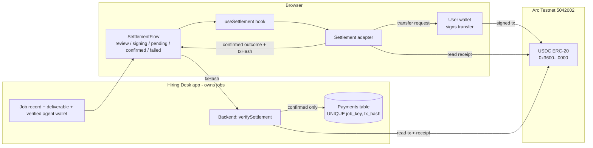

# Architecture: Arc USDC settlement for the Hiring Desk

Generated in [Arc Studio](https://studio.arc.io). Scope: the payment step only. The Hiring Desk keeps owning jobs, deliverables and agent profiles. Nothing is migrated into Arc.

## 1. File structure

```
src/
  settlement/                  Framework-free payment module (browser + Node). No React.
    index.ts                   Public surface. Host code imports only from here.
    config.ts                  Arc network + verified USDC token (the only place that knows them)
    types.ts                   Typed request / response / state interfaces
    errors.ts                  SettlementError codes + wallet/RPC error classification
    amount.ts                  Exact bigint amount parsing/formatting (decimals from config)
    api.ts                     PaymentReceipt + JSON response shapes for the host API
    request.ts                 Request validation, checksum + allow-list enforcement
    client.ts                  Read-only viem client factory (cannot sign)
    receipt.ts                 Receipt parsing + validation (pure)
    verify.ts                  verifySettlement(): fetch tx + receipt, decide pending/confirmed/failed
    ledger.ts                  Ledger contract + small key-value implementation
    adapter.ts                 createSettlementAdapter(): preflight, sign, wait, verify
    serialize.ts               bigint-safe JSON for sending an outcome to a backend
  hooks/useSettlement.ts       wagmi <-> adapter glue; holds UI state, no payment logic
  lib/settlementRuntime.ts     Browser wiring: public client, localStorage ledger, adapter
  components/
    settlement/                Drop-in React payment step
      SettlementFlow.tsx       review -> signing -> pending -> confirmed | failed
      ReviewCard.tsx           Pre-signing review + wallet connect / network switch
      StatusPanels.tsx         Signing, pending, confirmed, failed panels
      ui.tsx, types.ts         Shared primitives, SettlementJob type
    JobHarness.tsx             Stand-in for the Hiring Desk job record (demo only)
  config.ts                    wagmi config (Arc Testnet, injected wallet)
tests/settlement.test.ts       23 unit tests for validation, amounts and the ledger
docs/                          This file, PROVENANCE.md, SECURITY-REVIEW.md
```

## 2. Wallet connection

- `src/config.ts`: wagmi config, injected wallet connector, Arc Testnet.
- `src/main.tsx`: wagmi, React Query and ConnectKit providers (scaffold file, unchanged).
- `src/components/settlement/ReviewCard.tsx`: Connect wallet and Switch network buttons (ConnectKit, `useSwitchChain` via the hook).
- `src/hooks/useSettlement.ts`: reads `useAccount`, `useWalletClient`, `useSwitchChain`.

The wallet client is the only signer. It is created by the user's wallet and handed to the adapter.

## 3. USDC transfer

`src/settlement/adapter.ts` (`settle`): runs `transfer(recipient, amount)` on the ERC-20 USDC contract through `walletClient.writeContract`, after a balance check and a dry-run simulation. It never sends native value.

## 4. Receipt verification

- `src/settlement/receipt.ts` (`validateReceipt`): pure checks on a fetched transaction and receipt.
- `src/settlement/verify.ts` (`verifySettlement`): fetches them, checks live chain id and confirmations, then calls `validateReceipt`.

`validateReceipt` requires: chain id match, `status = success`, `to` = verified token, `value = 0`, calldata is exactly `transfer(recipient, amount)`, sender matches the expected wallet, and exactly one token `Transfer` log matches sender, recipient and amount. On Arc, an extra native-view `Transfer` log from `0xfffffffffffffffffffffffffffffffffffffffe` is cross-checked (amount x 10^12) and never counted as the transfer. The mirror log was observed on live Arc Testnet receipts; it is not taken from official docs, so its absence is tolerated and a mismatch is rejected.

## 5. Arc network and token configuration

`src/settlement/config.ts` only. Values are literals (the module has no Studio-specific imports) and were confirmed live against `https://rpc.testnet.arc.io` on 2026-11-06:

| Item | Value | Live check |
| --- | --- | --- |
| Chain | Arc Testnet, ID 5042002 | `eth_chainId` = `0x4cef52` |
| RPC | https://rpc.testnet.arc.io | responds |
| Explorer | https://explorer.testnet.arc.io | from registry |
| USDC (ERC-20) | `0x3600000000000000000000000000000000000000` | `symbol()` = USDC |
| Decimals | 6 (ERC-20 view). Native gas view is 18. | `decimals()` = 6 |

The adapter re-reads `decimals()` and `symbol()` from the token before every first payment per session and refuses if they disagree with the config.

## 6. Public integration functions

Browser (client signs):

```ts
import { createSettlementAdapter, createSettlementPublicClient, createKeyValueLedger } from '@/settlement'

const adapter = createSettlementAdapter({
  publicClient: createSettlementPublicClient(5042002),
  ledger: myLedger, // durable, ideally backed by the Hiring Desk database
})

const outcome = await adapter.settle(
  { chainId, tokenAddress, recipientAddress, amountBaseUnits, jobKey },
  walletClient, // viem WalletClient from the user's wallet
  { onProgress },
)
// outcome.status: 'pending' | 'confirmed' | 'failed'. Never throws.
```

Node backend (read-only, no keys):

```ts
import { verifySettlement, createSettlementPublicClient } from '@/settlement'

const outcome = await verifySettlement(createSettlementPublicClient(5042002), request, txHash, {
  expectedSender: clientWalletOnRecord,
  ledger: hiringDeskLedger,
})
if (outcome.status === 'confirmed') markJobPaid(outcome) // the only path to "paid"
```

Request fields: `chainId`, `tokenAddress`, `recipientAddress`, `amountBaseUnits` (bigint), `jobKey`.

Confirmed outcome fields: `txHash`, `status`, `sender`, `recipient`, `transferredAmount`, `tokenAddress` (verified from the receipt), `chainId`, `receipt` (parsed), `explorerUrl`.

## 7. Frontend states

| Phase | Shown when | Source |
| --- | --- | --- |
| review | Before signing. Shows job reference, deliverable link, exact amount, network, token address, recipient name, full recipient address, connected wallet. Blocks on missing deliverable, wrong network, low balance. | `ReviewCard` |
| signing | Wallet prompt is open, nothing sent yet | `progress.stage = awaiting_signature` |
| pending | Hash exists, receipt not yet verified. Includes RPC-outage warning and Check again. | `outcome.status = pending` |
| confirmed | Only after `validateReceipt` accepted the receipt | `outcome.status = confirmed` |
| failed | Rejected, insufficient funds, wrong network, RPC failure, reverted, receipt mismatch, duplicate | `outcome.status = failed` |

## 8. Security assumptions

- The wallet signs. No private key is requested, stored, or present in the code (no `privateKeyToAccount`, no server signer).
- The Hiring Desk supplies `recipientAddress` from its own verified records. The harness form is a demo only.
- The host re-verifies on the server with `verifySettlement` before marking a job paid. A browser callback alone is not proof.
- The host enforces `UNIQUE(job_key)` and `UNIQUE(tx_hash)`. The built-in browser ledger covers one browser only.
- Anything that could report false success is closed by routing every `confirmed` through `validateReceipt`. Anything that could expose keys: nothing handles keys, and `.env` is never read by this module.
- The deliverable link is rendered only if it is an `https:` URL.

## Diagram



```
Hiring Desk job --> SettlementFlow --> adapter --> user wallet (signs) --> Arc USDC
                                          |                                  |
                                          +------ receipt read & validated --+
Hiring Desk backend --> verifySettlement --> Arc RPC --> mark paid (unique tx_hash)
```
