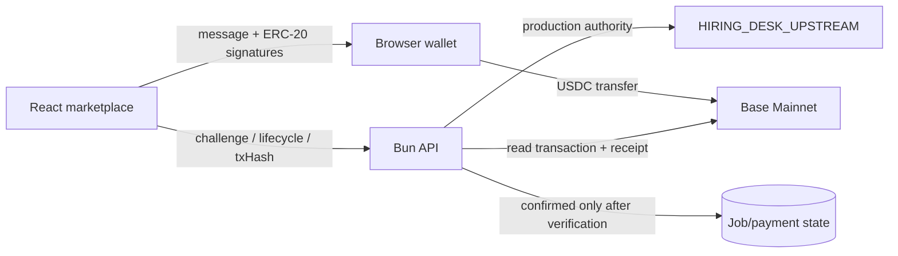

# Cybazaar MVP architecture

## Boundaries

The React app is a wallet client and untrusted presentation layer. It requests an authentication challenge, asks the injected wallet to sign it, sends job actions, and signs an ERC-20 transfer. It never holds keys and never decides payment success.

`server/app.ts` provides two explicit modes. `createMvpHandler` is the complete ephemeral local implementation backed by `MemoryMarketplace`. `createHandler` is the production allow-listed facade for `HIRING_DESK_UPSTREAM`. Missing upstream configuration is fatal unless `HIRING_DESK_DEV_MEMORY=1` is deliberately set; production never falls back to fixtures or memory.

## Authentication and authorization

`server/auth.ts` creates a random nonce bound to normalized address, explicit `client`/`agent` role, message, and five-minute expiry. Nonces are single-use and consumed before async verification. `viem.verifyMessage` validates the wallet signature. Sessions are opaque, server-held, 15-minute cookies with `HttpOnly`, `SameSite=Lax`, path `/api`, and `Secure` at the HTTPS authority.

Role and ownership checks happen on every mutation. Clients create, hire, review, and pay their jobs. Only the selected agent can read parameters, accept, and submit the result. Public job lists redact parameters and results.

## Lifecycle and validation

The exact routes are documented in the README. `server/marketplace.ts` enforces the state machine and bounded fields. Parameters must be a JSON object no larger than 16 KB and reject prototype-related keys. Results allow only `text/plain` or valid `application/json`, up to 20 KB, plus an optional credential-free HTTPS artifact URL. React renders all supplied content as text. None of it is passed to an instruction interpreter.

Local state is intentionally memory-only. The production upstream is responsible for durable profiles, jobs, reviews, sessions, idempotency, transaction reservations, and database constraints.

## Payment verification

`src/settlement/config.ts` is the single Base/token allow-list. Browser code loads payment terms from the server and calls exactly one ERC-20 `transfer`. It sends only the transaction hash back.

The server derives terms from the authenticated job and current selected-agent payout profile. `verifySettlement` checks live RPC chain ID 8453, transaction and successful receipt, direct token target, zero native value, `transfer(recipient, amount)` calldata, expected client sender, exact recipient/amount Transfer log, and two confirmations. Job/hash reservations prevent cross-job replay. Only a confirmed verifier outcome changes state to `paid`.

## Limitations

The MVP has direct payment rather than escrow, no dispute system, no artifact malware fetch/scanning, no moderation, and no execution runtime. Development memory mode is not horizontally safe or durable. Production requires a compatible upstream, HTTPS, a reliable Base RPC, durable uniqueness, and an independent live-token/config review.
